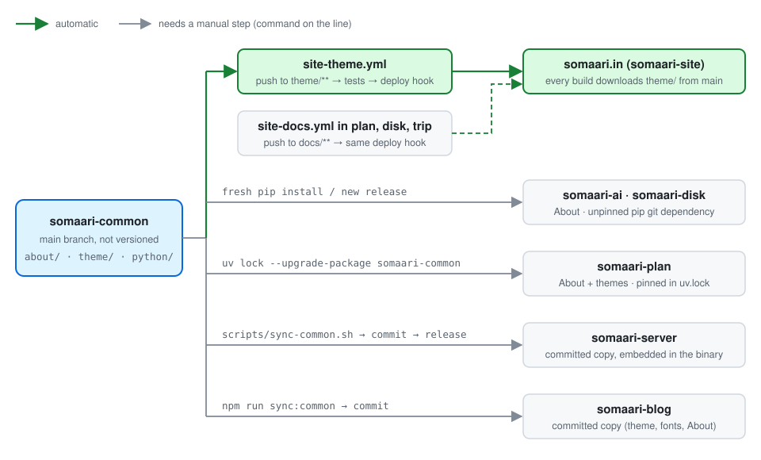

# somaari-common

Single source of truth for what somaari apps share:

- the **About** section, used by all somaari apps (somaari-ai, somaari-disk, somaari-plan, and future apps). The standard is [docs/ABOUT_SPEC.md](docs/ABOUT_SPEC.md).
- the **themes** (four themes, the seasonal schedule, the theme picker and fonts), used by the themed web apps: somaari-site, somaari-plan and the blog at blog.somaari.in (somaari-blog). The standard is [docs/THEME_SPEC.md](docs/THEME_SPEC.md).

somaari-common is not versioned: apps always use the latest `main`.

## Contents

- `about/developer.json`: developer info (schema: `about/developer.schema.json`)
- `about/debug-fields.json`: debug fields every app must report
- `python/`: `somaari_about`, the Python adapter
- `scripts/sync-about.sh` / `sync-about.ps1`: vendor the JSON into non-Python apps
- `theme/`: `theme.js`, `themes.css`, `fonts/` and `files.json` (the files an app serves at `/theme/`)
- `python/somaari_theme`: serves `theme/` from Python web apps (`static_dir()`, `files()`)

## Integrating

**Python apps:**

```
somaari-common @ git+https://github.com/ashwinkrpi/somaari-common#subdirectory=python
```

```python
from somaari_about import collect, as_text, load_developer
text = as_text(collect("my-app", __version__), load_developer())
```

**Other languages:**

```sh
../somaari-common/scripts/sync-about.sh vendor/somaari-about
```

Then write a native collector that outputs exactly the keys in `debug-fields.json`, in the text format from the spec.

## Themes

Serve `theme/` at `/theme/` and load `/theme/theme.js` and `/theme/themes.css` before the app's own stylesheet. A Python web app serves `somaari_theme.static_dir()`; a static site downloads the files in `theme/files.json` at build time. somaari-blog (Astro) instead commits a copy made by its `npm run sync:common`, so run that there after changing `theme/` or `about/`. Markup, tokens and the rules for changing them: [docs/THEME_SPEC.md](docs/THEME_SPEC.md).

A push that changes `theme/` on `main` runs the tests and rebuilds somaari.in (`.github/workflows/site-theme.yml`, repo secret `SOMAARI_SITE_DEPLOY_HOOK`).

## How apps pick up changes

Every app reads `main`, but each one picks up a change at a different time. Only somaari.in updates on its own.



| App | Uses | How it gets somaari-common | Picks up a change when |
|---|---|---|---|
| somaari-site (somaari.in) | themes | its build downloads the files in `theme/files.json` from `main` | automatically: a push to `theme/**` rebuilds it |
| somaari-ai, somaari-disk | About | unpinned pip git dependency (somaari-disk also bundles it into its `.deb` and Windows builds) | the venv is reinstalled; for somaari-disk users, the next release |
| somaari-plan | About, themes | uv git dependency, pinned in `uv.lock` | you run `uv lock --upgrade-package somaari-common` and commit |
| somaari-server | About, themes | committed copy in `vendor/somaari-about/` and `web/theme/`, embedded in the binary | you run `scripts/sync-common.sh`, commit and release |
| somaari-blog | About, themes, fonts | committed copy from `npm run sync:common` | you run `npm run sync:common` and commit |

**After changing somaari-common:**

1. Run the tests (reinstall `./python` first) and push to `main`. Changes to `theme/` rebuild somaari.in. Changes to `about/` or `python/` trigger nothing.
2. Update each app that should get the change, using the step in the table. For somaari-blog, also diff `vendor/somaari-common/theme/themes.css` to check the colours in its `global.css`.
3. The sync scripts read the committed `main` of the somaari-common checkout next to the app, not the working tree. They refuse to run while `theme/` has uncommitted changes.

**After changing an app:**

- Nothing reaches somaari-common. A shared change has to be made here.
- Don't edit the vendored copies (`vendor/somaari-about/`, somaari-server's `web/theme/`, somaari-blog's `vendor/somaari-common/` and `src/assets/fonts/`). The next sync overwrites them.
- In somaari-plan, somaari-disk and somaari-trip, a push to `docs/**` on `main` runs `site-docs.yml`, which uses the same deploy hook. That rebuild also downloads the latest `theme/` from here.

## Development

```sh
python3 -m venv .venv
.venv/bin/pip install pytest jsonschema ./python
.venv/bin/python -m pytest
```

Reinstall `./python` after editing `about/*.json`, `theme/` or the package. Tests check the installed copy against the source. The theme tests need `node`.

## Contributing

This is a personal project and doesn't accept pull requests; only collaborators can open them.
You're welcome to fork it and adapt it for yourself, and bug reports in
[Issues](https://github.com/ashwinkrpi/somaari-common/issues) are appreciated.
